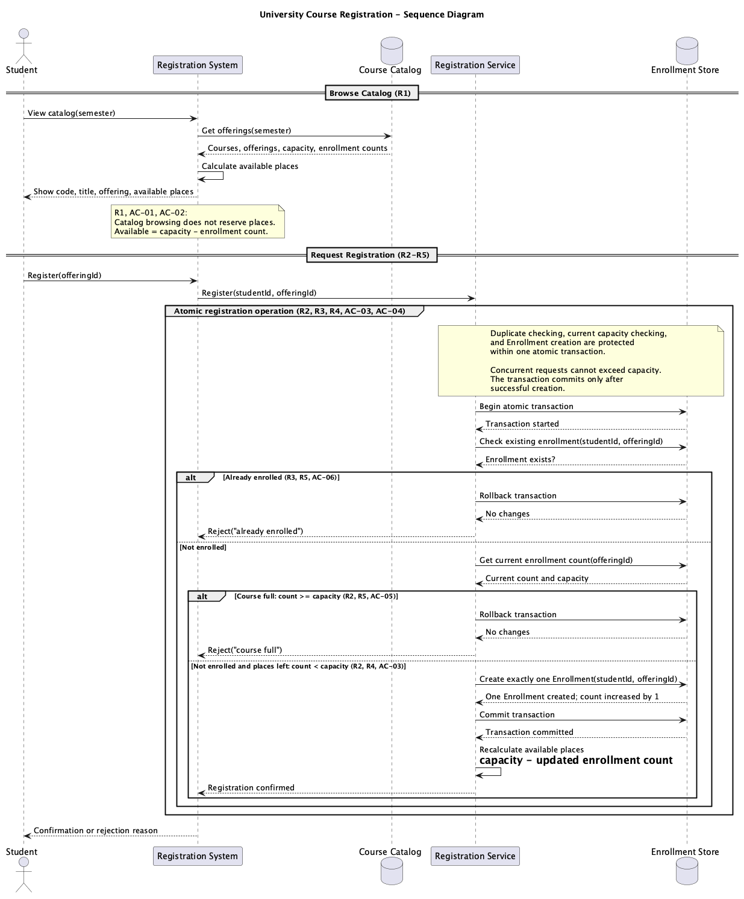
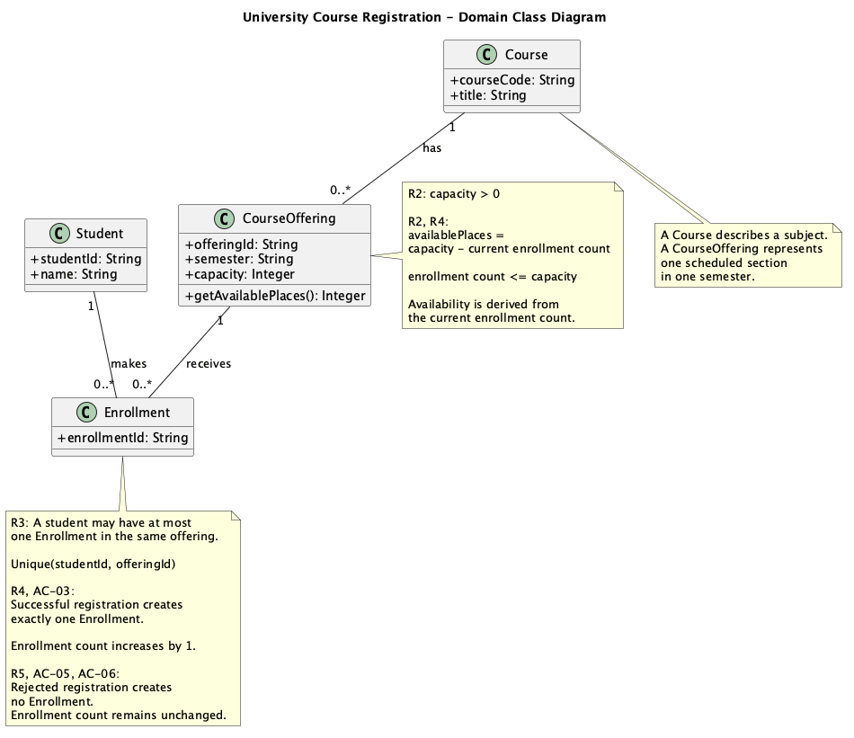
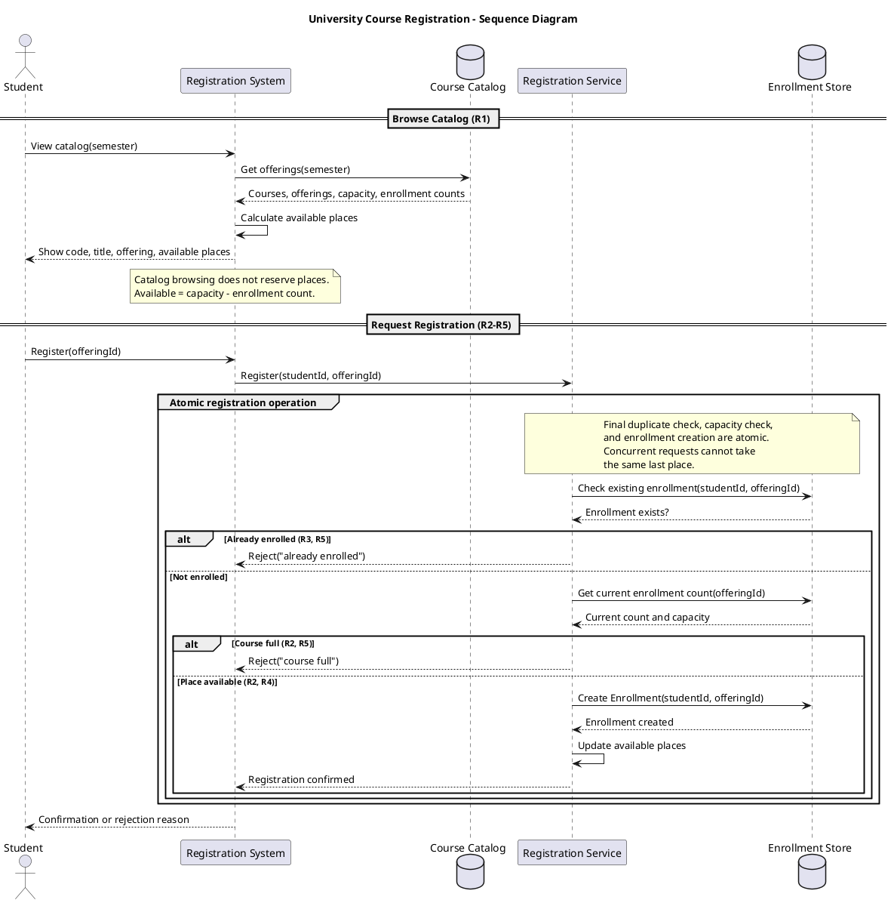
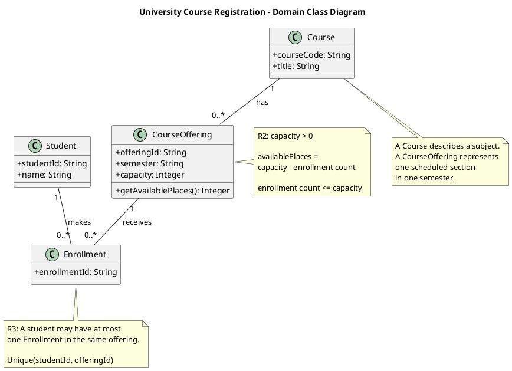
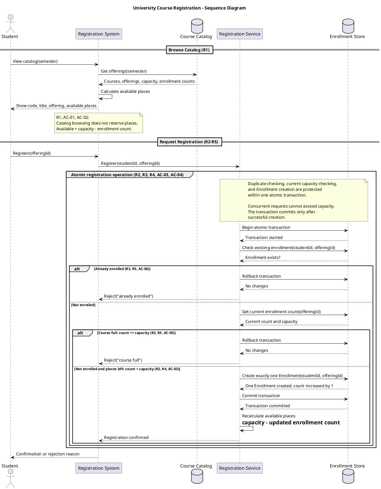
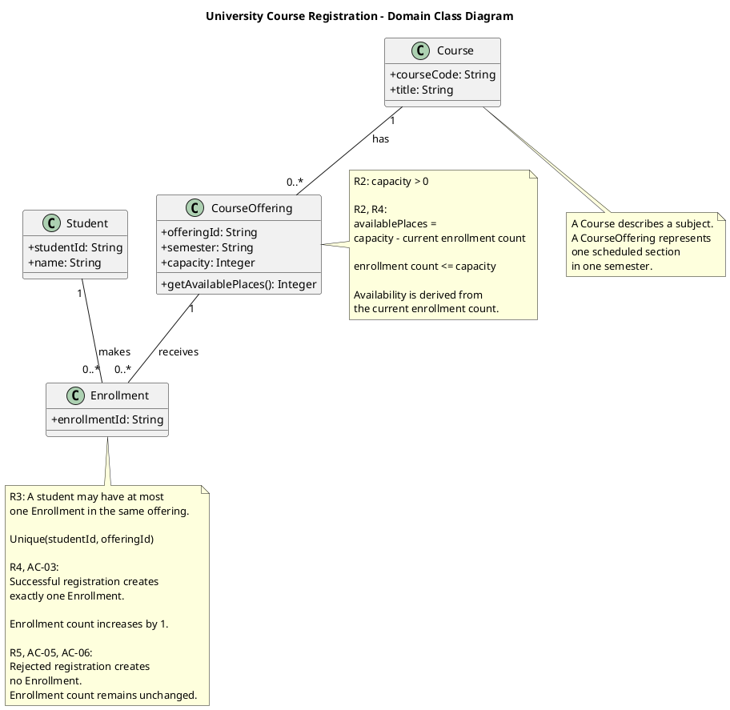
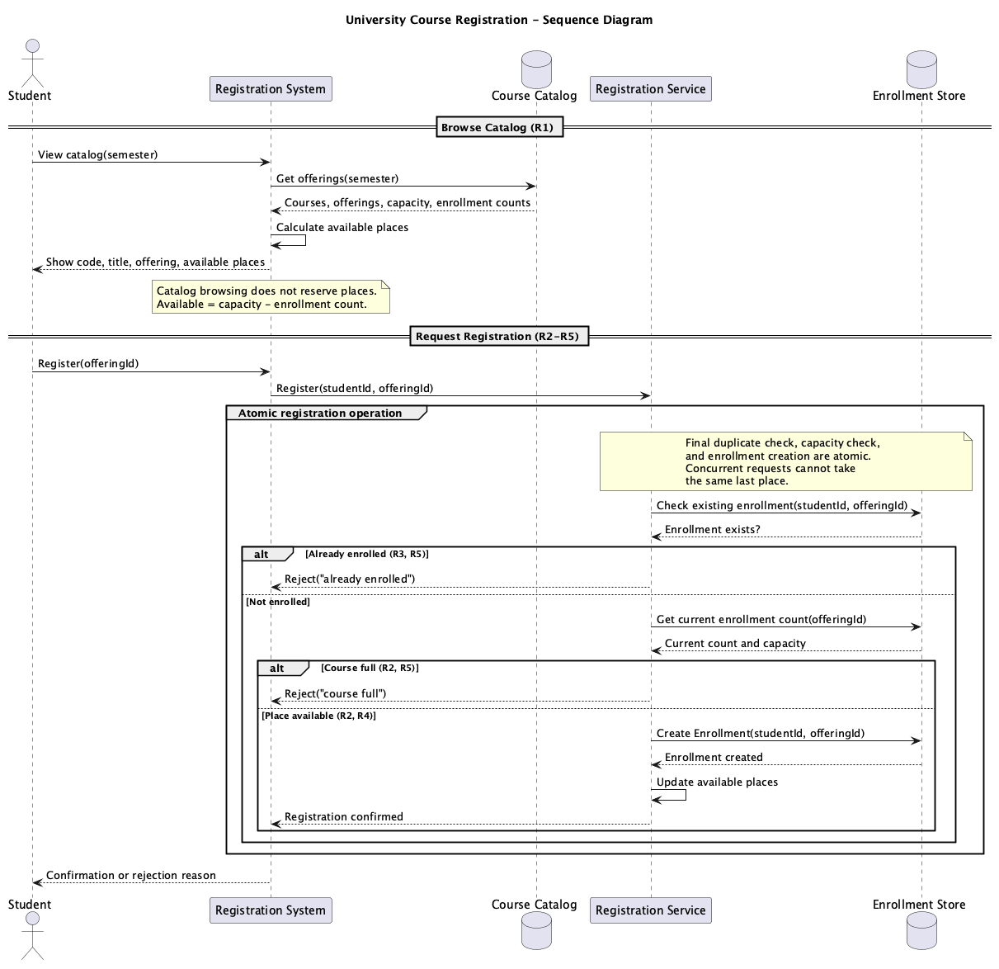
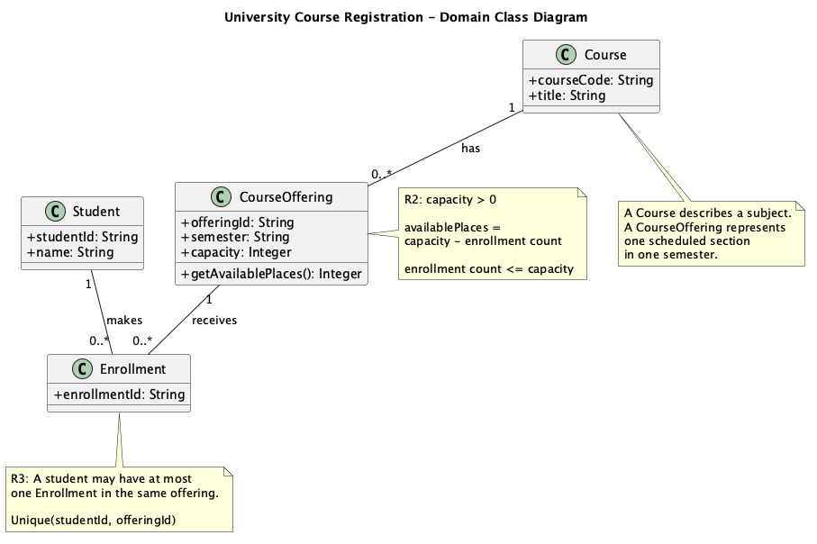

# SIS #02 — AI-Assisted UML Modeling: University Course Registration

## 1. Scope and assumptions

**Scope:** Students can browse one semester catalog, view current available places, and register for a specific course offering. The system performs final capacity and duplicate checks, confirms success, or explains rejection without changing data. Payments, prerequisites, timetable clashes, waiting lists, and cancellation are excluded.

**Assumptions:**

1. Students are signed in and the selected offering exists.
2. Each offering has positive capacity and an accurate current enrollment count.

## 2. User stories and acceptance criteria

### US-01 — Browse offerings

**US-01:** As a student, I want to browse course offerings for a semester, so that I can see course details and available places.

- **AC-01** (R1): Given a signed-in student, When the student opens the semester catalog, Then the system shows the course code, title, offering, and available places.
- **AC-02** (R1, R2): Given an offering with capacity 30 and 25 enrollments, When the student views the catalog, Then the system shows 5 available places and does not reserve one.

### US-02 — Register for an offering

**US-02:** As a student, I want to register for a specific offering, so that I can enroll when a place is available.

- **AC-03** (R2, R3, R4): Given Alice is not enrolled and one place remains, When Alice requests registration, Then exactly one Enrollment is created, the count increases by one, availability is recalculated, and confirmation is returned.
- **AC-04** (R2, R4): Given exactly one place remains, When Alice and Bob request registration concurrently, Then only one registration succeeds and the enrollment count never exceeds capacity.

### US-03 — Receive a clear rejection

**US-03:** As a student, I want to receive a clear rejection when registration is not allowed, so that I understand the reason.

- **AC-05** (R2, R5): Given a full offering, When Alice requests registration, Then the system responds "course full", creates no Enrollment, and leaves the count unchanged.
- **AC-06** (R3, R5): Given Alice already has an Enrollment in an offering, When she registers again, Then the system responds "already enrolled", creates no Enrollment, and leaves the count unchanged.

## 3. Sequence diagram

**Participants:** Student initiates catalog browsing and registration. Registration System receives requests and returns results. Course Catalog supplies offerings and counts. Registration Service applies registration rules. Enrollment Store checks and creates Enrollment records.

**Atomic operation:** The Registration Service begins one atomic transaction covering the final duplicate check, current capacity check, and creation of exactly one Enrollment. It commits on success and rolls back on either rejection. Concurrent transactions must serialize or lock the relevant offering to prevent oversubscription. A catalog view only calculates availability and reserves nothing.

**Where the Enrollment is created:** In the success branch, Registration Service sends `Create exactly one Enrollment(studentId, offeringId)` to Enrollment Store. This creates one instance of the `Enrollment` class in section 4 and increases the offering enrollment count by one.

**Technical lifelines:** Registration System is the user-facing interface; Course Catalog is the read/query component; Registration Service coordinates transaction rules; Enrollment Store is the persistence component. They are technical sequence lifelines rather than domain classes, so their absence from the domain class diagram is intentional.

## 4. Class diagram

| Association | Read left to right | Read right to left |
| --- | --- | --- |
| Course — CourseOffering | One Course has zero or many CourseOfferings. | Each CourseOffering belongs to exactly one Course. |
| Student — Enrollment | One Student makes zero or many Enrollments. | Each Enrollment belongs to exactly one Student. |
| CourseOffering — Enrollment | One CourseOffering receives zero or many Enrollments. | Each Enrollment belongs to exactly one CourseOffering. |

**How an Enrollment links a student to an offering:** Every Enrollment belongs to exactly one Student and exactly one CourseOffering. A student or offering may have zero or many enrollments across different pairs.

**Capacity constraint:** `capacity > 0` and `enrollment count <= capacity`; `availablePlaces = capacity - current enrollment count`. A `0..*` multiplicity cannot express a variable, offering-specific capacity limit.

**Uniqueness constraint:** `Unique(studentId, offeringId)` prevents the same student from enrolling twice in the same offering. Association multiplicities do not prohibit repeated links for the same pair.

## 5. Traceability

| Rule and criterion | Model evidence | Validation case |
| --- | --- | --- |
| R1 + AC-01, AC-02 | Browse Catalog messages show code, title, offering, and calculated places; Course and CourseOffering attributes. | Extra catalog check: 30 - 25 = 5, no reservation. |
| R2 + AC-02, AC-03, AC-04, AC-05 | Atomic final count check; `count < capacity` guard; CourseOffering capacity note. | T1, T2, T3; concurrent last-place reasoning. |
| R3 + AC-03, AC-06 | Existing-enrollment check and `Unique(studentId, offeringId)` note. | T4. |
| R4 + AC-03, AC-04 | Create exactly one Enrollment; count +1; commit; recalculate places; confirmation. | T1, T2. |
| R5 + AC-05, AC-06 | Rollback and distinct "course full" and "already enrolled" responses. | T3, T4. |

## 6. Walkthroughs

| Case | Observed path and state change | Judgment and evidence |
| --- | --- | --- |
| T1. Available | With capacity 2 and count 0, the duplicate check is false and count < capacity; create one Enrollment, commit, count 0 → 1, and confirm. | Pass — success branch, Create Enrollment and Commit transaction messages. |
| T2. Last place | With capacity 2 and count 1, the atomic current-count check allows the final place; create exactly one Enrollment, count 1 → 2, then confirm. | Pass — atomic group and count < capacity guard. |
| T3. Full | Although the earlier catalog showed availability, the current count is now 2 of 2; the final capacity check rejects, rolls back, and keeps count 2 → 2. | Pass — Course full guard, Rollback transaction, rejection message. |
| T4. Duplicate | Alice already has an Enrollment for this offering; the first final check detects it, rolls back without creating a record, and keeps count 1 → 1. | Pass — Already enrolled guard, Rollback transaction, rejection message. |

## 7. Review decisions

| AI suggestion or model element | Decision | Reason | Rule |
| --- | --- | --- | --- |
| Original atomic group only stated atomicity | Accepted and modified | I added explicit transaction begin, commit, and rollback messages to clarify the protected operation. | R2, R4 |
| Ambiguous availability update | Accepted | I replaced the vague update with recalculation from the updated enrollment count, avoiding a second independent source of truth. | R4 |
| Success branch did not explicitly say exactly one record and count +1 | Accepted | I made both state changes explicit so AC-03 can be checked directly. | R4 |

## 8. Modeling explanation

The two UML diagrams describe the same course registration process from different viewpoints. The sequence diagram focuses on message order and behavior. First, a student opens the semester catalog. The system requests offering information and calculates available places as capacity minus the current enrollment count. This is only a display operation. It does not reserve a place, because another student may register before the first student submits a request.

When registration is requested, the Registration Service starts an atomic transaction. It checks whether the student is already enrolled in the selected offering. If so, it rejects the request without creating a record. Otherwise, it checks the current enrollment count against capacity. If the course is full, it also rejects the request without changing the count. Only when both checks pass does the system create exactly one Enrollment, increase the count by one, commit the transaction, recalculate available places, and return confirmation. The transaction must protect the final checks and creation together so two concurrent requests cannot take the same last place.

The class diagram shows the permanent domain concepts. Course is a subject, while CourseOffering is a section in one semester. Enrollment connects exactly one Student to exactly one CourseOffering. The uniqueness note prevents duplicate registration for the same pair. The capacity note explains a numerical restriction that association multiplicities alone cannot show. The technical lifelines in the sequence diagram represent application components, not extra domain entities. An activity diagram could also show the decisions and rejection paths clearly, but the sequence diagram is better for showing communication and transaction boundaries.

## 9. Reflection

In this assignment, I used AI to draft requirements and create the first versions of two UML diagrams. It helped me organize the normal registration path and the two rejection cases. However, I did not treat the first output as a final answer. I compared the diagrams with R1–R5 and the acceptance criteria and looked for messages that were unclear.

One important decision was to make the atomic registration operation more explicit. The first sequence diagram said that the operation was atomic, but it did not show where the transaction started or ended. I accepted this review point and added transaction messages. I also changed the availability update into a recalculation based on the new enrollment count. This avoids suggesting that availability is a separate value that can become inconsistent.

The remaining limitation is that UML diagrams do not prove that a real database implementation prevents concurrent updates. In a real system, transaction isolation and a uniqueness constraint would still need implementation and testing. I learned that AI diagrams are useful drafts, but each important rule must be checked by a person.

## 10. Appendix A — Before AI
**Scope:**
The system allows students to browse courses and register for a specific course offering. It checks available places and prevents duplicate registration.

**Initial assumptions:**
1. Students are already signed in.
2. Each course offering has a positive capacity.
3. Availability is checked again before registration.

## 11. Appendix B — AI exchanges

**Instructor review note:** B1 and B3 response text below is reconstructed from the approved results, not a verbatim chat export. Replace it with the exact actual AI replies before treating this as a complete audit trail. Check all prompts and metadata against the real exchanges. B2 original UML sources are copied from the recorded initial diagrams.

### B1 — Requirements (Prompt A)

- **Tool:** ChatGPT
- **Model:** GPT-6
- **Date:** 2026-10-16
- **Purpose:** draft 3 user stories and 6 acceptance criteria

**Prompt:**

~~~~text
Act as a requirements analyst. Use only this course registration scenario and rules R1–R5: R1: The catalog shows course code, title, offering and available places for one semester.
R2: Registration rechecks the current capacity and never exceeds the offering capacity.
R3: Duplicate registration for the same student and offering is rejected.
R4: Success creates exactly one Enrollment, updates availability and returns confirmation.
R5: Full or duplicate requests are rejected with a reason and no state changes. My initial assumptions are The system allows students to browse courses and register for a specific course offering. It checks available places and prevents duplicate registration.
1. Students are already signed in.
2. Each course offering has a positive capacity.
3. Availability is checked again before registration.
Draft 3 user stories and 2 Given / When / Then acceptance criteria for each. Use IDs US-01 to US-03 and AC-01 to AC-06. Map each criterion to rule IDs.
Cover normal and rejection behavior. List uncertainty separately. Do not add excluded features or invent university policies.
~~~~

**Response:**

~~~~text
US-01: As a student, I want to browse course offerings for one semester, so that I can see available courses and places.
AC-01 (R1): Given a signed-in student, When the student opens the semester catalog, Then the system shows course code, title, offering, and available places.
AC-02 (R1, R2): Given capacity 30 and 25 enrollments, When the student views the catalog, Then the system shows 5 available places without reserving a place.
US-02: As a student, I want to register for a specific course offering, so that I can enroll if a place is available.
AC-03 (R2, R3, R4): Given Alice is not enrolled and one place is available, When Alice requests registration, Then exactly one Enrollment is created and confirmation is returned.
AC-04 (R2, R4): Given one place is left and two students request it at the same time, When both register, Then only one succeeds and capacity is not exceeded.
US-03: As a student, I want a clear rejection reason, so that I understand why registration was not accepted.
AC-05 (R2, R5): Given a full course, When Alice requests registration, Then the system rejects with "course full" and no state changes.
AC-06 (R3, R5): Given Alice is already enrolled, When she requests the same offering again, Then the system rejects with "already enrolled" and no state changes.
Uncertainty: exact database locking strategy is not specified.
~~~~

### B2 — UML drafts (Prompt B)

- **Tool:** ChatGPT
- **Model:** GPT-6
- **Date:** 2026-10-16
- **Purpose:** draft the sequence and class diagrams

**Prompt:**

~~~~text
Using my approved scenario, R1–R5, stories and criteria below, return separate PlantUML code blocks for a sequence diagram and a domain class diagram.
Sequence: include catalog browsing and guarded success, full-course and duplicate outcomes. Model final checks and creation as one atomic operation.
Class: show domain concepts, useful attributes and multiplicities. State the capacity and uniqueness constraints. Explain assumptions and any technical lifelines.

Approved requirements:
R1: The catalog shows course code, title, offering and available places for one semester.
R2: Registration rechecks the current capacity and never exceeds the offering capacity.
R3: Duplicate registration for the same student and offering is rejected.
R4: Success creates exactly one Enrollment, updates availability and returns confirmation.
R5: Full or duplicate requests are rejected with a reason and no state changes.
US-01: As a student, I want to browse course offerings for one semester, so that I can see available courses and places.
AC-01 (R1): Given a signed-in student, When the student opens the semester catalog, Then the system shows course code, title, offering, and available places.
AC-02 (R1, R2): Given capacity 30 and 25 enrollments, When the student views the catalog, Then the system shows 5 available places without reserving a place.
US-02: As a student, I want to register for a specific course offering, so that I can enroll if a place is available.
AC-03 (R2, R3, R4): Given Alice is not enrolled and one place is available, When Alice requests registration, Then exactly one Enrollment is created and confirmation is returned.
AC-04 (R2, R4): Given one place is left and two students request it at the same time, When both register, Then only one succeeds and capacity is not exceeded.
US-03: As a student, I want a clear rejection reason, so that I understand why registration was not accepted.
AC-05 (R2, R5): Given a full course, When Alice requests registration, Then the system rejects with "course full" and no state changes.
AC-06 (R3, R5): Given Alice is already enrolled, When she requests the same offering again, Then the system rejects with "already enrolled" and no state changes.
~~~~

**Response:**

~~~~text
Sequence diagram:

Class diagram:

~~~~

### B3 — Model critique (Prompt C)

- **Tool:** ChatGPT
- **Model:** GPT-6
- **Date:** 2026-10-16
- **Purpose:** review both models against R1–R5 and T1–T4

**Prompt:**

~~~~text
Review these two UML models against R1–R5 and my acceptance criteria. Check message order, guards, state changes, multiplicities and naming.
Inspect the four validation cases: available places, exactly one place, full course after a stale catalog view, and duplicate registration.
For each issue, cite the affected rule and model element. Explain the impact and propose a focused correction. Separate genuine defects from optional design choices.

Approved requirements:
R1: The catalog shows course code, title, offering and available places for one semester.
R2: Registration rechecks the current capacity and never exceeds the offering capacity.
R3: Duplicate registration for the same student and offering is rejected.
R4: Success creates exactly one Enrollment, updates availability and returns confirmation.
R5: Full or duplicate requests are rejected with a reason and no state changes.
US-01: As a student, I want to browse course offerings for one semester, so that I can see available courses and places.
AC-01 (R1): Given a signed-in student, When the student opens the semester catalog, Then the system shows course code, title, offering, and available places.
AC-02 (R1, R2): Given capacity 30 and 25 enrollments, When the student views the catalog, Then the system shows 5 available places without reserving a place.
US-02: As a student, I want to register for a specific course offering, so that I can enroll if a place is available.
AC-03 (R2, R3, R4): Given Alice is not enrolled and one place is available, When Alice requests registration, Then exactly one Enrollment is created and confirmation is returned.
AC-04 (R2, R4): Given one place is left and two students request it at the same time, When both register, Then only one succeeds and capacity is not exceeded.
US-03: As a student, I want a clear rejection reason, so that I understand why registration was not accepted.
AC-05 (R2, R5): Given a full course, When Alice requests registration, Then the system rejects with "course full" and no state changes.
AC-06 (R3, R5): Given Alice is already enrolled, When she requests the same offering again, Then the system rejects with "already enrolled" and no state changes.

Original sequence:

Original class:

~~~~

**Response:**

~~~~text
Review summary (reconstructed from accepted decisions; replace with the exact Prompt C response from chat):
1. The atomic group states a guarantee but does not show transaction boundaries (R2, R4, AC-04). Add begin, commit and rollback.
2. "Update available places" is ambiguous (R4). Derive it from capacity minus current enrollment count.
3. The successful branch should explicitly state one Enrollment and count +1 (R4, AC-03).
4. Technical lifelines are an acceptable abstraction choice when explained in section 3.
5. The catalog is read-only: showing available places is not a reservation. This is correct under R1 and R2, so no change is needed.
6. The class diagram uses Student, Course, CourseOffering and Enrollment and shows all three associations. Each Enrollment links exactly one student and one offering. Keep these domain classes and multiplicities because they already express the intended relationships.
7. The capacity note correctly says that the enrollment count cannot exceed the offering capacity. The uniqueness note correctly says that the same student and offering pair cannot have duplicate enrollments. Keep both notes and make the successful count increment explicit.
8. For T1 and T2, the available and last-place cases should create exactly one Enrollment and return confirmation. For T3, the stale catalog view must not bypass the final capacity check. For T4, the duplicate check must reject before creation. Rejection paths must not change the enrollment count.
9. The exact database isolation or locking implementation is not specified by the domain requirements; the UML should show the required atomic guarantee without inventing a particular database product.
~~~~

### B4 — Focused revision (Prompt D)

- **Tool:** ChatGPT
- **Model:** GPT-6
- **Date:** 2026-10-16
- **Purpose:** apply my accepted review decisions

**Prompt:**

~~~~text
Revise the UML sources using only my accepted review decisions: 1. Clarify the existing atomic registration group so duplicate checking, current capacity checking, and creation are protected as one operation. 2. Replace the ambiguous availability update with recalculation from the updated enrollment count. 3. Explicitly show that successful registration creates exactly one Enrollment and increases the count by one. 4. Make the three outcomes clearly identifiable: already enrolled, course full, and not enrolled and places left. Keep existing class names, technical lifelines, multiplicities, and constraints. Keep justified existing elements and explain each change.
Preserve the agreed scope and rule IDs. Return both updated PlantUML blocks and a concise change log. Flag any unresolved issue.
Approved requirements:
R1: The catalog shows course code, title, offering and available places for one semester.
R2: Registration rechecks the current capacity and never exceeds the offering capacity.
R3: Duplicate registration for the same student and offering is rejected.
R4: Success creates exactly one Enrollment, updates availability and returns confirmation.
R5: Full or duplicate requests are rejected with a reason and no state changes.
US-01: As a student, I want to browse course offerings for one semester, so that I can see available courses and places.
AC-01 (R1): Given a signed-in student, When the student opens the semester catalog, Then the system shows course code, title, offering, and available places.
AC-02 (R1, R2): Given capacity 30 and 25 enrollments, When the student views the catalog, Then the system shows 5 available places without reserving a place.
US-02: As a student, I want to register for a specific course offering, so that I can enroll if a place is available.
AC-03 (R2, R3, R4): Given Alice is not enrolled and one place is available, When Alice requests registration, Then exactly one Enrollment is created and confirmation is returned.
AC-04 (R2, R4): Given one place is left and two students request it at the same time, When both register, Then only one succeeds and capacity is not exceeded.
US-03: As a student, I want a clear rejection reason, so that I understand why registration was not accepted.
AC-05 (R2, R5): Given a full course, When Alice requests registration, Then the system rejects with "course full" and no state changes.
AC-06 (R3, R5): Given Alice is already enrolled, When she requests the same offering again, Then the system rejects with "already enrolled" and no state changes.
Original sources:

My review decisions and evidence: accept explicit transaction boundaries, derived availability, exactly one Enrollment, and clear outcome labels; preserve existing technical lifelines and class associations.
~~~~

**Response:**

~~~~text
Final sequence:

Final class:

Change log: Added transaction boundaries and rollback; derived availability from the updated count; stated exactly one Enrollment and count +1; clarified success, full, and duplicate outcomes. Unresolved: exact concurrency control is implementation-specific.
~~~~

## 12. Appendix C — Original diagrams

## 13. Appendix D — References and source checks

### References

- SIS #02 course README.md, section 1 "The system" and sections on diagrams and validation (course-provided file, accessed 2026-10-16).
- PlantUML, "Sequence Diagram", https://plantuml.com/sequence-diagram (verify page before submitting).
- PlantUML, "Class Diagram", https://plantuml.com/class-diagram (verify page before submitting).

### Source checks

| Modeling decision | Source and locator | What the source says | How it supports or changed your model |
| --- | --- | --- | --- |
| Atomic registration and final checks | SIS #02 README.md, section 1 "The system", R2–R5 (accessed 2026-10-16) | The rules require final capacity and duplicate checks and prohibit changes on rejection. | I grouped the final checks and creation in one transaction and added rollback branches. |
| Diagram message alternatives | PlantUML, "Sequence Diagram", https://plantuml.com/sequence-diagram; accessed 2026-10-16 (verify page before submitting) | PlantUML sequence syntax uses `alt` and `else` for alternatives. | I used nested alternatives for duplicate, full, and successful registration outcomes. |
